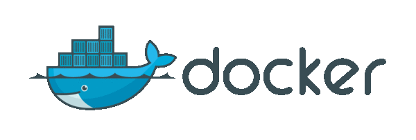

[docker-machine](https://docs.docker.com/machine/) is a really powerful tool to control your remote docker daemons.
Let's see how to configure everything to manage your remote containers easily from your local host.



## Remote server

### Docker machine user

Add a user on the remote server to control your docker daemon:

```bash
sudo adduser dockeradmin
```

Create a custom ssh key and add it on the remote server
to allow connection with this user.

```bash
ssh-keygen -t rsa -b 2048
ssh-copy-id -i ~/.ssh/dockeradmin.pem [-p 22345] dockeradmin@domain.fr
```

### Sudo or not sudo

Your user must have `sudo` access without asking for password:

```bash
$ sudo nano /etc/sudoers

# User alias specification
dockeradmin      ALL=(ALL) NOPASSWD: ALL
dockeradmin      ALL=(ALL) NOPASSWD: /bin/netstat
```

### Netstat

Your user must have `netstat` access.
As I'm using a **grs** kernel I need to create a wrapper to add `netstat` access
for the dockeradmin user:

```bash
$ cat netstat
#!/bin/bash
exec /usr/bin/sudo /bin/netstat "$@"

$ chmod +x netstat
$ sudo cp netstat /usr/local/bin/
```

### Iptables

By default docker-machine uses port `2376` to communicate with docker daemons.
Of course we need to open this port on the remote server:

```bash
# Docker machine port 2376
iptables -t filter -A INPUT -p tcp --dport 2376 -j ACCEPT
iptables -t filter -A OUTPUT -p tcp --dport 2376 -j ACCEPT
```

### Docker daemon

`docker-machine` and `generic` driver do not work with `aufs` storage driver.
So we need to explicitly define the `storage-driver` as `devicemapper`
on the server daemon side and on the docker-machine client.

On my remote server, my processes are managed by `systemd`,
a part of this configuration is automatically updated by the docker-machine client:

```bash
$ sudo cat /etc/systemd/system/docker.service
[Service]
ExecStart=/usr/bin/docker daemon -H tcp://0.0.0.0:2376 -H unix:///var/run/docker.sock --storage-driver devicemapper --tlsverify --tlscacert /etc/docker/ca.pem --tlscert /etc/docker/server.pem --tlskey /etc/docker/server-key.pem --label provider=generic
MountFlags=slave
LimitNOFILE=1048576
LimitNPROC=1048576
LimitCORE=infinity
Environment=

[Install]
WantedBy=multi-user.target
```

## Local configuration

### Install docker-machine

[https://docs.docker.com/machine/install-machine/](https://docs.docker.com/machine/install-machine/)

```bash
$ docker-machine version
docker-machine version 0.6.0, build e27fb87
```

### Create your first machine

The command to start your `docker-machine` is the following. Note the use of specific:

- ssh port
- ssh key

**Very important,** the `--engine-storage-driver devicemapper` configuration:

```bash
docker-machine create -d generic \
--generic-ssh-user dockeradmin \
--generic-ssh-key ~/.ssh/dockeradmin.pem \
--generic-ssh-port 22XXX \
--engine-storage-driver devicemapper \
--generic-ip-address domain.fr \
MACHINE_NAME

$ docker-machine ls
NAME           ACTIVE   DRIVER    STATE     URL                          SWARM   DOCKER    ERRORS
MACHINE_NAME   -        generic   Running   tcp://domain.fr:2376           v1.11.0

```

### Switch between environments

```bash

$ docker-machine env MACHINE_NAME
export DOCKER_TLS_VERIFY="1"
export DOCKER_HOST="tcp://domain.fr:2376"
export DOCKER_CERT_PATH="/home/USER/.docker/machine/machines/MACHINE_NAME"
export DOCKER_MACHINE_NAME="MACHINE_NAME"

# Run this command to configure your shell:
$ eval $(docker-machine env MACHINE_NAME)
```

Execute a `docker ps` and you will control your remote daemon and see your remote containers.

Reset your client configuration to manage your local containers.

```bash
$ eval $(docker-machine env --unset)
```

## Sources

- [http://www.thegeekstuff.com/2016/02/docker-machine-create-generic/](http://www.thegeekstuff.com/2016/02/docker-machine-create-generic/)
- [https://docs.docker.com/engine/admin/systemd/](https://docs.docker.com/engine/admin/systemd/)
- [https://blog.dahanne.net/2015/10/07/adding-an-existing-docker-host-to-docker-machine-a-few-tips/](https://blog.dahanne.net/2015/10/07/adding-an-existing-docker-host-to-docker-machine-a-few-tips/)
- [https://docs.docker.com/engine/admin/configuring/](https://docs.docker.com/engine/admin/configuring/)
